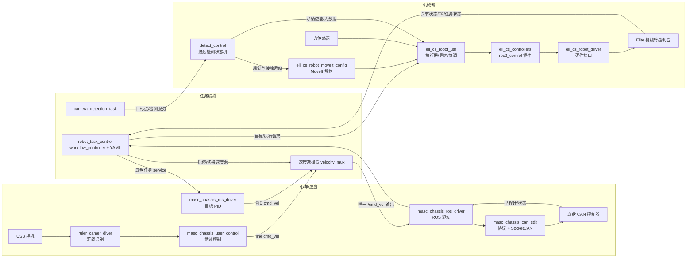

# 代码逻辑与维护导航

本文按“运行时数据怎么走”和“修改应该落在哪一层”整理工作区，供后续改功能时快速定位。当前主要运行入口是 ROS 2 `ros_ws/src`；Elite SDK、相机厂商驱动属于底层/第三方依赖，`ros_ws/legacy` 是归档内容，不是当前构建入口。

## 一句话结构

任务层决定“先做什么、何时开始/停止”；底盘和机械臂功能层把任务变成运动命令；驱动层连接 CAN 或机器人控制器；相机、力传感器、测厚仪、工控机通讯提供观测和外围能力。跨包优先通过 ROS topic、service、配置文件连接，尽量不要让任务层直接操作硬件协议。

## 当前主要数据流

集成循迹任务的速度主题分开：目标 PID 输出 `/robot_control/pid/cmd_vel`，循迹输出 `/robot_control/line_follow/cmd_vel`，`velocity_mux` 选中一个后统一发往 `/cmd_vel`。排查底盘运动时按这个链路逐段看，不要先改底盘 CAN 协议。

其它设备是按任务加载的：工控机 9010 通道负责命令/状态/检测结果，9002 和 9030 分别承载海康照片与 RGB-D 数据；力传感器为导纳/接触判断提供力数据，测厚仪在检测保持阶段按需触发。通讯实现集中在 `eli_cs_robot_serial/device/`，任务不应自行再建一套 TCP/串口协议。

### 一次典型“循迹 + 机械臂”任务

常用入口是 [`line_follow_arm_test.launch.py`](../src/robot_task_control/launch/line_follow_arm_test.launch.py)，系统组件由 [`internal/robot_system.launch.py`](../src/robot_task_control/launch/internal/robot_system.launch.py) 组合，动作顺序保存在 [`line_follow_arm_test.yaml`](../src/robot_task_control/config/line_follow_arm_test.yaml)：

1. 启动底盘 ROS 驱动和 PID、USB 蓝线相机/识别、机械臂驱动、MoveIt、导纳/力传感器、速度选择器及任务控制器。外控连接与设备就绪检查通过后才进入任务。
2. 任务控制器读取 YAML。`auto_start` 决定启动后自动运行还是等待 `/task_controller/start`。
3. `line_follow` 步骤切换速度源并启用循迹。图像识别只输出线状态/中线几何；循迹控制器把几何误差变成速度命令。
4. 到站后任务控制器等待底盘停稳，按 YAML 执行机械臂关节姿态与点位动作；MoveIt 运动由 `moveit_pose_executor` 执行，柔顺运动由导纳控制器执行。
5. 动作完成后继续循迹或结束。任务状态发布在 `/task_controller/status`，底盘与循迹各自也有状态 topic。

实际步骤以使用的 workflow YAML 为准；`line_follow_arm_test`、`line_follow_only`、相机检测和单独导纳是不同入口，不应同时启动多个会控制同一设备的任务。

## 包的职责与代码入口

| 子系统 | 主要代码 | 负责什么 | 改动通常从哪里开始 |
|---|---|---|---|
| 底盘 CAN 协议/通讯 | `masc_chassis_can_sdk/include`、`src/chassis_protocol.cpp`、`src/socketcan_transport.cpp` | CAN 帧编码解码、SocketCAN 收发、反馈缓存 | 协议字段/单位或 CAN 收发行为 |
| 底盘 ROS 驱动 | `masc_chassis_ros_driver/src/chassis_ros_driver_node.cpp`、`target_pid_controller_node.cpp`、`config/ros2/` | ROS 命令/状态桥接、里程计、目标 PID、底盘服务 | `/cmd_vel`、状态发布、PID 参数或任务位移 |
| 底盘用户控制 | `masc_chassis_user_control/scripts/`、`config/`、`launch/` | 键盘遥控、循迹、路线记录/返程、自适应曝光 | 循迹算法与入口参数；视觉识别算法则在下行相机包 |
| 蓝线相机识别 | `ruier_camer_diver/src/line_tracking.cpp`、`line_tracker_node.cpp`、`config/line_tracker.yaml` | 图像采集、蓝线识别和中线/状态输出 | 颜色阈值、识别结果、相机采集 |
| 机械臂硬件 | `eli_cs_robot_driver/include`、`src/`、`launch/` | Elite 控制器连接、ros2_control 硬件接口、Dashboard/Primary 通讯 | 真机连接和硬件状态接口；SDK 协议本身在 `Elite_Robots_CS_SDK` |
| 机械臂模型/规划 | `eli_cs_robot_description/urdf`、`eli_cs_robot_moveit_config/{srdf,config,launch}` | URDF/Xacro、末端模型、碰撞、关节限制、MoveIt 规划和控制器映射 | 模型、工具坐标、规划组、规划器、姿态配置 |
| 机械臂控制策略 | `eli_cs_controllers/`、`eli_cs_robot_usr/src/`、`eli_cs_robot_usr/launch/` | ros2_control 控制器、MoveIt 执行、导纳、键盘/阶段协调 | 运动执行或导纳逻辑；勿在此改底层 Elite 通讯 |
| 任务编排与统一启动 | `robot_task_control/robot_task_control/workflow_controller.py`、`launch/`、`config/` | YAML 工作流、等待/超时/状态、安全暂停、速度选择、联动入口 | 先改 workflow/config；新增动作或状态机行为才改 Python 控制器 |
| 相机点检测 | `robot_task_control/camera_detection_task.py`、`detect_control/scripts/detect_controller.py`、`geminipro_camer_calibration/` | 取点批次协调、坐标变换、MoveIt 接近/撤离、限力与结果记录 | 点来源/批次流程在 task；接触执行在 detect_control；坐标/TF 在 calibration |
| 工控机/传感器通讯 | `eli_cs_robot_serial/device/industrial_pc/`、`device/sensor/`、`device/detactor/` | 主机 TCP 协议、状态/结果转发、力传感器和测厚仪 | 协议和唯一 ROS 桥接优先改此处及配套 `host_tools/` |
| 深度/海康相机 | `gemini_pro_ros2/`、`hik_camera_ros2_driver-main/` | 厂商相机驱动 | 驱动参数/设备行为；上层流程放在 calibration 或 task 包 |
| 公共 ROS 接口 | `eli_common_interface/`、`masc_chassis_msgs/`、`eli_dashboard_interface/` | msg/srv 定义 | 改接口要同步所有发布者、订阅者和调用者 |

另有 `eli_cs_robot_simulation_gz` 提供仿真入口；`ros_ws/legacy/COLCON_IGNORE` 标明历史 ROS 包不参与当前 colcon 构建。`gemini_pro_ros2`、`hik_camera_ros2_driver-main` 和 Elite SDK 含厂商/第三方代码，除非任务确实涉及驱动问题，不建议顺手重排这些目录。

## 常用入口和配置位置

| 要做的事 | 入口/配置 |
|---|---|
| 逐站循迹与机械臂联动 | `robot_task_control/launch/line_follow_arm_test.launch.py` + `config/line_follow_arm_test.yaml` |
| 仅循迹/记录路线/返程 | `robot_task_control/launch/line_follow_only.launch.py`；低层独立入口 `masc_chassis_user_control/launch/line_follow.launch.py` |
| 键盘控制底盘 | `robot_task_control/launch/keyboard_teleop.launch.py` 或 `masc_chassis_user_control/launch/keyboard_teleop.launch.py` |
| 仅机械臂导纳 | `robot_task_control/launch/arm_admittance_only.launch.py`；参数在 `eli_cs_robot_usr/config/` |
| 相机点真机检测 | `robot_task_control/launch/camera_detection_real.launch.py` + 相应 `config/camera_detection_real.yaml` |
| 检测器本体/接触参数 | `detect_control/config/detect.yaml` |
| 机械臂行驶/检测姿态 | `eli_cs_robot_moveit_config/config/arm_joint_postures.yaml` |
| 工控机 TCP 参数 | `eli_cs_robot_serial/device/industrial_pc/config/industrial_pc.yaml`；协议实现和主机工具在同目录 |
| CAN 接口/底盘限值 | `masc_chassis_ros_driver/config/ros2/driver_params.yaml` |

`robot_task_control/launch/internal/` 是被常用 launch 复用的组件组合入口；正常改任务流程优先改 YAML 或外层入口，只有公共驱动组合变化时才调整 `robot_system.launch.py` / `detection_system.launch.py`。

## 常用 ROS 接口

| 接口 | 主要用途 | 相关实现 |
|---|---|---|
| `/robot_control/pid/cmd_vel`、`/robot_control/line_follow/cmd_vel` | 两种底盘速度来源 | 底盘 PID、循迹控制器 |
| `/cmd_vel` | 速度选择器输出给底盘驱动的唯一集成命令 | `robot_task_control/velocity_mux.py`、底盘 ROS 驱动 |
| `/wheel_odom` | 底盘里程计反馈 | 底盘 ROS 驱动、PID、循迹和任务控制器 |
| `/chassis/task_control`、`/chassis/task_status` | 定距/转角底盘任务请求与完成状态 | `target_pid_controller_node`、`workflow_controller.py` |
| `/line_follow_controller/enable`、`/line_follow/status` | 启停循迹、读取循迹状态 | `masc_chassis_user_control`、任务控制器 |
| `/task_controller/start`、`/task_controller/stop`、`/task_controller/status` | 启停 workflow、查询当前动作/阶段 | `robot_task_control/workflow_controller.py` |
| `/moveit_pose_executor/target_poses`、`/moveit_pose_executor/execute_latest` | 发送并执行 MoveIt 姿态目标 | `eli_cs_robot_usr` 执行器、workflow |
| `/admittance_controller/target_poses`、`/sensor/wrench` | 柔顺目标和外力反馈 | 导纳控制器、力传感器驱动 |
| `/industrial_pc/result` | 主机检测结果进入 `camera_detection_task`，由其校验本次采集批次后转换目标 | `eli_cs_robot_serial/device/industrial_pc`、`robot_task_control/camera_detection_task.py` |
| `/industrial_pc/camera_points` | TCP 桥发布的类型化 PoseArray；与 `result` 是不同接口，不会自动触发相机检测协调器 | `eli_cs_robot_serial/device/industrial_pc`；需要时由应用接入坐标转换流程 |
| `/detect_controller/start`、`/detect_controller/status`、`/detect_controller/point_result` | 接触检测任务及逐点结果 | `detect_control` |

## 按现象定位

- **相机画面/线识别错误**：先看相机原图和 `ruier_camer_diver` 的状态/中线输出，再看 `line_follow_control.py` 的输入几何与配置；这时还未到 CAN 层。
- **识别正确但车不走/方向错**：检查循迹 `/robot_control/line_follow/cmd_vel`、速度选择器当前模式/使能、最终 `/cmd_vel`、底盘故障/急停/遥控状态和 CAN 通讯状态。
- **底盘能遥控但任务不推进**：查看 workflow 状态、当前 YAML action、底盘任务状态、循迹状态和设备就绪门控。
- **机械臂不执行**：依次看 Elite 外控/硬件状态、控制器 active、MoveIt 规划结果或导纳状态/力数据、任务控制器阶段。检查 `robot_description` 与 MoveIt 控制器映射时分别看 description、moveit_config 和 driver。
- **相机点触碰偏差**：核对毫米/米单位、点的表达坐标系、观测时刻 TF、`terminal_link_1` 相机安装、`terminal_link_2` 探针偏移及 tool0 补偿；再检查接近方向与力传感器轴向。
- **主机收不到状态/照片或点位**：检查 `industrial_pc` ROS 节点和 9010/9002/9030 对应通道、协议结果批次/照片清单，再看主机 `host_tools/`；不要另写一个重复 TCP 转发节点。

## 后续重构建议

目前职责边界已能按包区分，但 `workflow_controller.py` 承担了 YAML 校验、任务状态机、设备就绪检查、底盘/机械臂动作、安全暂停和采图进程管理等多类职责，是后续最值得拆分的文件。建议先补齐/保留现有行为测试，再逐步提取纯数据校验、设备就绪检查和各动作执行器；每一步保持 ROS topic/service 和 YAML 格式兼容。不要一开始搬目录或同时改通信接口与状态机。

开始改动前可按“入口 launch → 实际节点 → ROS 接口 → 配置 → 对应测试”追一条完整路径。做完后优先跑所改包的单元/ROS launch 测试；涉及机械臂或底盘的运动行为，还需安排无硬件/mock 检查后再上实机。
