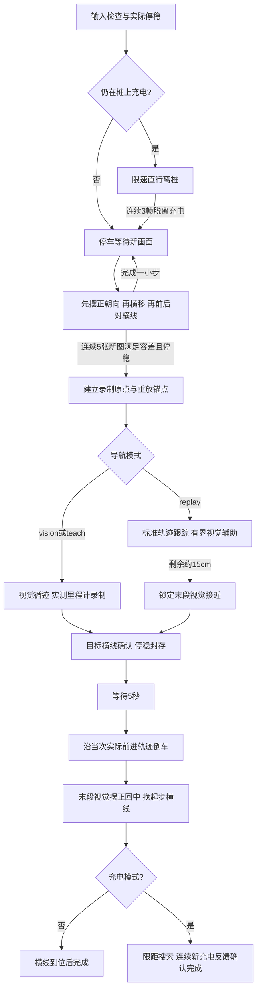

# 底盘循迹逻辑与实车测试

本次整理覆盖离桩、起步对齐、录制、前进重放、终点停车、倒车返回。机械臂、TCP通信沿用原流程。
这套控制借鉴 Nav2 的分阶段控制方法，没有引入完整 Nav2 导航栈、地图定位或代价地图避障。

## 一轮任务



任何阶段输入过期或底盘不允许运动都会发零速；越界、超时等锁定故障会终止工作流，不自动重试发车。
里程计到路径端点只负责切换阶段，不能替代实物横线到站，也不能替代充电确认。

## 控制职责

| 文件 | 职责 |
| --- | --- |
| `scripts/dock_departure.py` | 离桩确认、累计行程和超时 |
| `scripts/start_alignment.py` | 停车观察、误差过滤、规划一个小步、里程计执行与复核 |
| `scripts/forward_navigation.py` | 前进重放与视觉的仲裁、不可逆末段接管、丢线预算和末段围栏 |
| `scripts/recorded_route.py` | 实际位姿采样、路线坐标变换、弧长进度与 Pure Pursuit |
| `scripts/stop_marker.py` | 横线识别、起步线忽略、站点计数、接近限速与到站确认 |
| `scripts/reverse_visual.py`、`scripts/charging_dock.py` | 倒车末段摆正、横移、横线定位及充电 |
| `scripts/line_follow_node.py` | ROS输入新鲜度、底盘许可、阶段接线、速度输出和诊断 |
| `robot_task_control/workflow_controller.py` | 任务顺序、停稳、封存、等待、前进/倒车切换 |

前六项脚本位于 `src/masc_chassis_user_control/`。任务控制器位于 `src/robot_task_control/`。
相机处理和文件保存使用只保留最新任务的后台工作器，不积压旧帧；运动状态切换由单一控制循环处理。

## 本次调整的规则

1. **起步摆正再建立坐标基准。** 先等待实际停稳0.6秒，再采集5张稳定新图。
   每次只控制一个轴，最多转0.04rad或移动1.5cm，然后停车重新观察。
   图像横向容差从半图宽6%收紧到2%（640宽约6.4像素），切线角容差从0.12收紧到0.035rad（约2°）。
   这两个图像指标不能当作地面定位精度。重放还会用近端主线另做一致性复核。
2. **途中里程计主导，视觉同时检查横向和朝向。** 朝向歪但线恰好居中也允许纠偏。
   视觉角速度辅助为视觉控制量的0.5倍，限幅±0.06rad/s；总输出仍服从曲率和转速限制。
   横向偏差超过半图宽12%或近端图像切线超过0.10rad后连续降速，最低为原目标速度的40%。
   稳定视觉显示横向偏差超过80%时锁停。
3. **弯道按半径降速。** 前进重放曲率单独限为5/m，适配已有约5/m的弯道；
   `route_max_curvature: 2.0`继续用于原末段控制。所需转速超过上限时同步减小线速度，避免截断角速度后切弯。
4. **末段只接管一次。** 剩余约15cm进入`visual_finish`后，不再调用路径前瞻控制器，
   防止终点附近前瞻点落在车侧后方导致`standard_target_not_ahead`。
   此后最高0.02m/s，最多30秒、路径外额外找线最多5cm，累计行程与路线偏离仍受检查；
   相对末段路线切线的里程计朝向偏差超过0.9rad仍会锁停，不将真正掉头当成普通终点接管。
   无有效稳定视觉立即停；只有横线门控确认才算到站。
5. **丢线与停帧分开。** 中段相机持续产生新图但暂时找不到线，最多以0.05m/s沿已有路线继续5秒或30cm，任一到限锁停。
   连续3帧有效主线才恢复视觉辅助。相机停帧、里程计过期、处理超预算或底盘异常仍立即停车。
6. **录制与巡航分开。** `teach`默认0.03m/s；普通前进巡航参数默认0.1m/s，重放还受路线0.08m/s上限约束。
   倒车独立上限0.05m/s。标准文件只读，返程使用本次实际前进记录，不覆盖标准。

起步与末段仍要求新鲜图像，不能通过放宽图像过期时间解决CPU负载问题。
轮式里程计会受打滑影响；相机没有地面标定时不把像素误差虚构成米或真实车体角度。

## 开源参考与采用范围

本次核对了以下官方源码：

- [Nav2 Regulated Pure Pursuit](https://github.com/ros-navigation/navigation2/blob/main/nav2_regulated_pure_pursuit_controller/src/regulated_pure_pursuit_controller.cpp)：弧长前瞻、曲率与速度约束、接近阶段减速。
- [Nav2 regulation_functions](https://github.com/ros-navigation/navigation2/blob/main/nav2_regulated_pure_pursuit_controller/include/nav2_regulated_pure_pursuit_controller/regulation_functions.hpp)：曲率和终点接近限速分开处理。
- [Nav2 Rotation Shim](https://github.com/ros-navigation/navigation2/blob/main/nav2_rotation_shim_controller/src/nav2_rotation_shim_controller.cpp)：先摆正再交给路径跟踪器，阶段切换有独立条件。
- [Nav2 Simple Goal Checker](https://github.com/ros-navigation/navigation2/blob/main/nav2_controller/plugins/simple_goal_checker.cpp)：有状态的终点判定，已经进入后续阶段后不重复要求上一阶段的条件。

这里借鉴控制结构并针对现有全向底盘、单前置相机和横线停车实现适配；不是直接安装或等同于Nav2控制器。
现有循迹也不提供基于代价地图的动态避障。

## 实车测试：先用已有标准走一次往返

把车放回**原实物起步横线附近**，主线和横线都应可见。先结束上一轮launch。
这条命令会实际运动：对齐、去程、下一条有效横线停车、等待5秒、自动倒车回起步线；不开启额外充电搜索。

```bash
cd ~/project/robot_and_chassis_control/ros_ws
source /opt/ros/jazzy/setup.bash
source install/setup.bash

ros2 launch robot_task_control line_follow_only.launch.py \
  navigation_mode:=replay \
  standard_route_file:="$PWD/routes/standards/shuttle_test_01/standard_route.json" \
  round_trip:=true charging_mode:=false check_devices_on_startup:=false \
  workflow_file:="$(ros2 pkg prefix robot_task_control)/share/robot_task_control/config/line_follow_charge_test.yaml" \
  start_alignment:=true line_follow_speed:=0.075 line_reverse_speed:=0.05 \
  line_stop_marker_target_ratio:=0.5 line_show_window:=true \
  route_file:="$HOME/.ros/line_follow/replay_$(date +%Y%m%d_%H%M%S).json" \
  2>&1 | tee /tmp/chassis_replay_test.log
```

检查顺序：

1. 起步应先摆正、再回中、再对横线；每个小步结束后轮子停下再看图，不应边滑行边判断成功。
   `start_alignment_complete`后才能建立路径锚点或记录首点。
2. 去程状态中的`standard_route.controller.phase`应为`route`，偏线明显时速度应降低，弯道不应持续饱和后越走越偏。
   对比`geometry`（图像）与`standard_route.diagnostics`（米制里程计），二者单位不同。
3. 终点附近应只出现一次`route -> visual_finish`；只有实物目标横线确认且停稳才进入5秒等待。
   不应再因为前瞻点到了车后报错，也不能在没找到横线时凭里程计直接开始返程。
4. 返程检查原卡住弯道、末段摆正回中、起步横线到位。工作流完成才算整轮通过。
   如果途中故障，保留日志和这次时间戳路线；不要在中途位置直接重启，把那里当作标准起点。
5. 回到相同起点重复3轮，分别记录起步偏角、弯道偏线、终点横线停位和返程停位。
   软件检查通过不代表上述实车重复性已经通过。

本轮通过后，需要实测充电时仅把`charging_mode:=false`改为`true`；
仍使用上面的工作流，此时返程需连续新充电反馈确认才能结束。

## 重新录制标准

旧标准约2.071m、107点，仍完整保留。若旧录制本身偏线或相机安装已改变，应从实物起点重新录制，使用新名称：

```bash
ros2 launch robot_task_control line_follow_only.launch.py \
  navigation_mode:=teach route_name:=shuttle_aligned_v2 \
  round_trip:=true charging_mode:=false check_devices_on_startup:=false \
  workflow_file:="$(ros2 pkg prefix robot_task_control)/share/robot_task_control/config/line_follow_charge_test.yaml" \
  start_alignment:=true line_record_speed:=0.03 line_reverse_speed:=0.05 \
  line_stop_marker_target_ratio:=0.5 line_show_window:=true \
  route_file:="$HOME/.ros/line_follow/teach_$(date +%Y%m%d_%H%M%S).json" \
  2>&1 | tee /tmp/chassis_teach_test.log
```

此命令也会自动往返。到站停稳并封存后，合格记录归档到
`~/.ros/line_follow/standards/shuttle_aligned_v2/standard_route.json`及版本目录。
用该文件替换前一条重放命令的`standard_route_file`即可选择新标准。
`teach`返程同时受该轮0.03m/s运行设定约束；`line_reverse_speed:=0.05`只是上限。
质量报告检查结构与连续性，不会把偏线的记录自动改成胶带中心线。

## 软件回归检查范围

纯函数检查验证起步4.2°不能误判完成、视觉偏差限速、丢线预算、末段接管不可逆、末段时间/行程/偏离围栏及故障锁定。
隔离ROS话题检查验证实际节点接线、输入过期停车、录制/重放锚点延迟建立及倒车限速。
这些检查不连接CAN、不启动实车，也没有新增仿真器。
