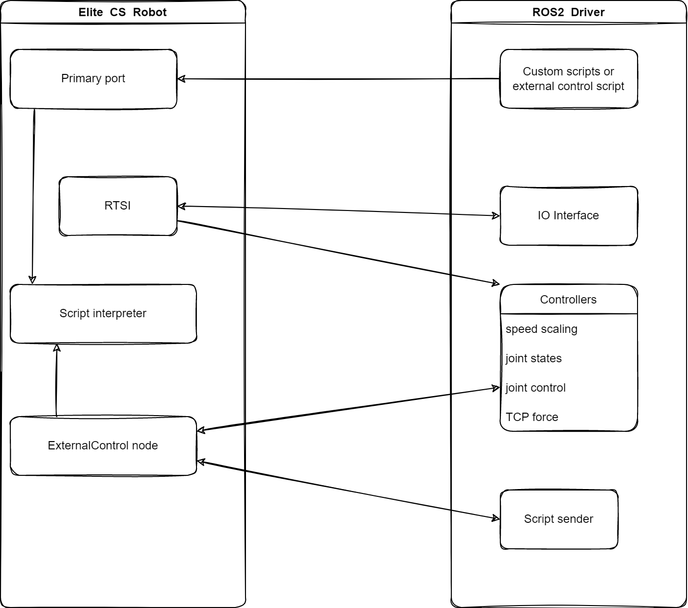

# eli_cs_robot_driver

此包包含Elite CS机器人系列的实际驱动程序。它是Elite_Robots_CS_ROS2_Driver仓库的一部分，依赖于该仓库中的其他包。有关如何安装和启动此驱动程序的信息，请参阅主仓库的README文件。

## 启动时自动上电和释放抱闸

`elite_control.launch.py` 默认 `auto_power_on=true`、`headless_mode=true`。真机按以下顺序启动：dashboard/primary连接 → 查询安全与机器人模式 → 必要时调用 `/dashboard_client/power_on` → 确认待机 `IDLE` → 调用 `/dashboard_client/brake_release` → 确认 `RUNNING` → 启动硬件接口与控制器。已处于 `RUNNING` 时跳过重复命令；假硬件模式不调用真机上电服务。启动辅助进程完成后退出，不常驻。

```bash
ros2 launch eli_cs_robot_driver elite_control.launch.py
```

原有 `robot_ip`、`local_ip`、`cs_type` 参数用法不变。默认总超时240秒（`power_on_timeout`），单次上电或释放抱闸服务最多等待120秒（`power_command_timeout`），状态查询回复等待10秒。SDK 的上电服务会等待机器人达到 IDLE/RUNNING 才返回，释放抱闸服务会等待 RUNNING 才返回，因此这两步允许较长等待；按实际状态顺序执行，不靠固定延时猜测完成；服务拒绝、响应超时或安全状态异常会取消后续控制器启动，不自动清除急停、保护停止或安全报警。需要保留原手动方式时，传 `auto_power_on:=false`。

这里只替代软件界面的上电、释放抱闸操作；远程控制、控制柜及示教器相关硬件配置仍按厂家要求处理，物理拔掉示教器后若触发安全停止，不能靠这两个服务绕过。参考[厂家快速使用指南4.1.1节](https://docs.elibot.cn/cs/1ffff/9a93b)。

## 技术细节

以下图示展示了该驱动程序架构的粗略概览。



机器人通过RTSI接口读取实时数据。一旦成功建立与机器人的连接，关节状态和IO数据将立即可用。

为了实际控制机器人，必须在机器人上运行External Control ELICOs的任务节点，用于解释从外部源发送的命令。当该程序没有运行时，将无法使用任何控制器来移动机器人。有关如何在机器人上安装和启动该程序的详细信息，请参见 [doc/ExternalControl-guide-cn.pdf](./doc/ExternalControl-guide-cn.pdf)。

可以通过主题的方式将自定义脚本片段发送到机器人。默认情况下，这会中断其他正在运行的程序（例如，控制机器人运动的程序）。对于某些特定的功能，可以将其作为sec脚本发送。有关详细信息，请参见 [Elite 文档](https://www.eliterobots.com/downloads)。

注意：如果启用了远程控制，机器人不会接受来自远程源的脚本代码，除非将机器人置于远程控制模式。但是，如果将其置于远程控制模式，包含ExternalControl任务节点的程序将无法通过教示器启动。为此，请使用dashboard服务来加载、启动和停止机器人上运行的主任务。基础机器人控制命令，例如上电、下电、释放抱闸、暂停、停止、解除保护停止和安全重启，也可以通过primary_client服务经由Primary端口执行。有关dashboard和primary服务的详细信息，请参阅 [ROS-API 文档](../doc/ROS2Interface_CN.md)。

该驱动程序使用ROS-Control进行所有控制语句。因此，它可以与ROS-Control中所有基于位置的控制器一起使用。然而，我们推荐使用来自eli_cs_controllers包中的控制器。有关详细信息，请参见 [该包文档](../eli_cs_controllers/README_CN.md)。注意：只有使用eli_cs_controllers中的控制器，才能获得速度缩放支持。

## 关于模式的说明

在本驱动程序中，"模式" 一词有不同的含义。

### 远程控制模式

&emsp;&emsp;机器人本身可以在不同的命令模式下操作：它可以处于 **本地控制模式**，即教示器是唯一的命令来源，或者处于 **远程控制模式**，在这种模式下，教示器的运动、启动和加载程序以及激活自由驱动模式等操作会被阻止。请注意，**远程控制模式** 必须在机器人的设置中显式启用，路径为 **设置** -> **系统** -> **远程控制**。有关详细信息，请参阅机器人的手册。

**远程控制模式** 是本驱动程序的许多功能所必需的，例如：
 * 无头模式（见下文）
 * 发送脚本代码到机器人
 * dashboard和primary功能，例如：
   * 在保护停机或急停后重启机器人
   * 启动机器人电源并解除刹车
   * 加载和启动程序

### 无头模式

&emsp;&emsp;在此驱动程序中，有一个 **无头模式**，可以启用或禁用。当启用 [无头模式](../doc/ROS2Interface_CN.md#headless_mode) 时，所需的外部控制脚本代码会在驱动程序启动时直接发送到机器人。当其他脚本代码通过此驱动程序直接发送到机器人，或通过教示器按下任何与运动相关的按钮时，该脚本将被该操作覆盖，并需要通过使用 [resend_external_script](../doc/ROS2Interface.md#resend_external_scriptstd_srvssrvtrigger) 服务重新启动。如果需要重新启动，您将看到驱动程序输出 `Connection to robot dropped, waiting for new connection.`。请注意，在教示器上按“Play”按钮不会重新启动外部控制程序，而是会加载当前加载在控制器上的程序。此模式不要求机器人上安装“ExternalControl” EliCOs，因为程序会直接发送到机器人。

## controller_stopper

&emsp;&emsp;这是一个小的辅助节点，用于根据布尔状态主题停止和重启ROS控制器。当状态变为`false`时，所有正在运行的控制器（除了预定义的 *consistent_controllers*）都会被停止。当状态返回为`true`时，已停止的控制器会被重新启动。

&emsp;&emsp;这是通过订阅机器人的运行状态主题来完成的。理想情况下，主题应该是保持的，并且只在状态变化时发布。然而，该节点只对状态变化作出反应，因此每个周期发布的状态也可以正常工作。
